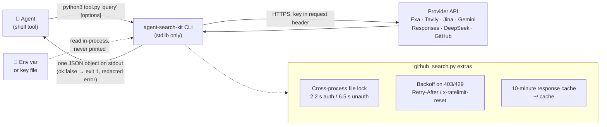

<div align="center">

# 🔎 agent-search-kit

**Small, uniform search and read CLIs for research agents. Each call prints one JSON object.**

[](https://github.com/sdpwh7-ux/agent-search-kit/actions/workflows/ci.yml)
[](LICENSE)
[](https://www.python.org/)
[](#-features)

**English** | [简体中文](README.zh-CN.md) | [日本語](README.ja.md)

Exa · Tavily · Jina · Gemini grounding · OpenAI-compatible Responses `web_search` (incl. xAI `x_search`) · DeepSeek Search/Fetch · rate-limited, cached GitHub search

</div>

---

## 🤔 Why

Coding and research agents are good at running shell commands and reading JSON. They are bad at remembering five different search APIs, their auth headers, their rate limits and their failure modes.

**agent-search-kit** gives them one convention:

```bash
python3 <tool>.py "query" [options]   ->   one JSON object on stdout
{"channel": "...", "ok": true, "results"|"answer"|"sources": ..., "latency_s": 1.4}
{"channel": "...", "ok": false, "error": "redacted message"}            # exit code 1
```

Every tool works the same way, so the agent does not need a separate prompt for each provider. If you tell it "run the tool, read the JSON", it can use all of them.

## ✨ Features

- 🧩 **One output contract.** Every tool prints one JSON object on stdout. Failures return `"ok": false` and exit code `1`.
- 📦 **Zero dependencies.** Uses only the Python 3.9+ standard library. No SDKs, no daemon.
- 🔑 **Keys are never printed.** Keys come from env vars or key files, and error text is redacted.
- 🌐 **Many channels.** Supports Exa, Tavily, Jina search and read, Gemini with Google Search grounding, any Responses API model with hosted tools, DeepSeek Search/Fetch, and GitHub.
- 🛰️ **Streaming Responses calls.** `web_search.py` streams, so long reasoning does not hit proxy timeouts.
- 🔁 **Reader fallback.** `jina_read.py` falls back to the free keyless reader on 401/402/429.
- 🐙 **GitHub search with rate-limit protection.** Includes a cross-process throttle, backoff on 403/429 and a 10-minute response cache.
- 🧭 **Prior-art finder.** `github_search.py similar owner/repo` finds and ranks related projects.
- 📊 **Optional usage accounting.** With [agent-usage-ledger](https://github.com/sdpwh7-ux/agent-usage-ledger) installed, HTTP calls are recorded per agent.
- 🧪 **Offline tests.** The test suite uses a local fake server and needs no internet or real keys.

## 🧰 Tools

| Tool | What it does | Needs |
| --- | --- | --- |
| `exa_search.py` | neural web search with snippets | `EXA_API_KEY` |
| `tavily_search.py` | web search, optional synthesized answer (`--answer`) | `TAVILY_API_KEY` |
| `jina_search.py` | web search with page markdown (`--max 0` = links only) | `JINA_API_KEY` |
| `jina_read.py` | URL -> clean markdown; falls back to the free keyless reader on 401/402/429, optional `--proxy` | optional `JINA_API_KEY` |
| `site_search.py` | search restricted to one domain (Exa, then Tavily) | Exa or Tavily key |
| `gemini_search.py` | Gemini with Google Search grounding: answer + issued queries + grounded sources | `GEMINI_API_KEY` |
| `web_search.py` | any **Responses API** model with hosted tools (`web_search`, `x_search`, ...): answer + cited URLs + number of searches. Streams, so long reasoning does not hit proxy timeouts | `RESPONSES_API_KEY` / `OPENAI_API_KEY` |
| `deepseek_search.py` | DeepSeek Search / Fetch tool API (+ `--balance`); cross-process QPS limiter, unescapes Fetch markdown | `DEEPSEEK_API_KEY` |
| `github_search.py` | `repos`, `similar` (find related projects by topics/keywords/language, scored), `readme`, `code`, `issues`, `rate` | optional `GITHUB_TOKEN` / `gh` |

## ⚙️ How it works



### Why the GitHub tool is more than a wrapper

Agents often fire ten GitHub searches in a row and then get rate-limited for an hour. `github_search.py` prevents that with:

- **A cross-process throttle.** A file lock is shared by every agent on the machine. It waits 2.2 s between authenticated searches and 6.5 s between unauthenticated ones.
- **Backoff on 403/429.** It uses `Retry-After`/`x-ratelimit-reset` to decide how long to wait.
- **A 10-minute response cache.**
- **Safe token handling.** The token is never put in argv or output. It is looked up in this order: `$GITHUB_TOKEN` -> `$GH_TOKEN` -> `gh auth token`, and read in-process.

`similar owner/repo` builds several queries from the repo's topics, description keywords and language. It merges the results and ranks them by shared rare topics, keyword hits and stars. This is useful for "find prior art / competitors" tasks.

## 🚀 Quick start

### Install

```bash
git clone https://github.com/sdpwh7-ux/agent-search-kit.git
cd agent-search-kit
cp examples/keys.env.example ~/.config/agent-search.env   # edit, chmod 600, and source it
```

### Usage

```bash
python3 exa_search.py "rust async runtime comparison" -n 5
python3 tavily_search.py "CVE-2026-xxxx nginx" --answer
python3 jina_read.py https://example.com/blog/post --max 8000
python3 site_search.py news.ycombinator.com "self-hosted LLM gateway"
python3 gemini_search.py "What changed in Python 3.14 free-threading?" --thinking high
python3 web_search.py "latest stable Kubernetes release and date" --model "$WEB_SEARCH_MODEL" --effort high
RESPONSES_BASE_URL=https://api.x.ai/v1 RESPONSES_API_KEY=... \
  python3 web_search.py "reactions to the new release" --model grok-4 --tools web_search,x_search
python3 deepseek_search.py search "向量数据库 选型" --n 10 --json
python3 deepseek_search.py fetch https://example.com/article
python3 github_search.py repos "mcp server postgres" --lang python --min-stars 50 --pushed-after 90d
python3 github_search.py similar owner/repo -n 10
python3 github_search.py rate
```

### Point your agent at it

Give your agent a short instruction like this:

> *"For web research run the tools in `/path/to/agent-search-kit`; each prints JSON. Prefer two independent channels for factual claims and cite the `url`s you used."*

## 🔧 Configuration

| Variable | Default | Meaning |
| --- | --- | --- |
| `AGENT_SEARCH_KEY_DIR` | `~/.config/agent-search` | directory of key files (`exa_key`, `tavily_key`, `jina_key`, `gemini_key`, `deepseek_key`, `responses_key`, `openai_key`) used when the env var is unset |
| `RESPONSES_BASE_URL` | `$OPENAI_BASE_URL` or `https://api.openai.com/v1` | Responses API endpoint for `web_search.py` |
| `WEB_SEARCH_MODEL` | - | default model for `web_search.py` |
| `GEMINI_BASE_URL` / `GEMINI_SEARCH_MODEL` | Google API / `gemini-flash-latest` | Gemini endpoint and model |
| `DEEPSEEK_BASE_URL` | `https://api.deepseek.com` | DeepSeek endpoint |
| `AGENT_SEARCH_PROXY` | - | proxy for the keyless Jina reader (`http://...` or `socks5h://...`) |
| `AGENT_SEARCH_STATE` / `GITHUB_SEARCH_STATE` | `~/.cache/agent-search` / `~/.cache/github_search` | rate-limit locks and cache |
| `AGENT_SEARCH_UA` | `agent-search-kit/0.1` | User-Agent |

**Optional usage accounting:** put [agent-usage-ledger](https://github.com/sdpwh7-ux/agent-usage-ledger)'s `usage_log.py` on `PYTHONPATH`, and every HTTP call is recorded per agent (`AGENT_NAME`).

## 🛡️ Security model

- 🌐 **Network.** Each tool talks only to its provider's API (or the base URL you configure). `jina_read.py` also talks to Jina's reader, which fetches the URL you pass. Queries and URLs are sent to third parties, so do not search for secrets or private URLs.
- 🔑 **Credentials.** Keys come from env vars or `AGENT_SEARCH_KEY_DIR` files (make them `chmod 600`). They are sent only as request headers to their own provider and are never printed. Error messages are redacted. `github_search.py` may call `gh auth token` in-process, and the token is not written anywhere. An agent that runs with these env vars can spend your API credit, so set provider-side spending limits.
- 🐚 **Shell.** No tool runs a shell. `jina_read.py --proxy` and `github_search.py --proxy` invoke `curl` with an argument list (no shell) and pass headers through stdin, so tokens never show up in `ps`.
- 📁 **Files.** The tools write only rate-limit lock files and the GitHub response cache (under `~/.cache`). The cache holds only public API responses.
- 🧨 **Prompt injection.** Search results and fetched pages are untrusted content. Agents should treat them as data, never as instructions.

## 🧪 Tests

```bash
python3 -m unittest discover -s tests -v   # local fake server; no internet, no real keys
```

## 🗺️ Project status & roadmap

This project was **just open-sourced** and is at version `0.1` (the default User-Agent is `agent-search-kit/0.1`). Interfaces may still change based on feedback.

- [x] Nine CLIs with a shared JSON output contract
- [x] Rate-limited, cached GitHub search with `similar` ranking
- [x] Offline test suite (local fake server)
- [ ] Collect feedback from real agent workflows. Issues and PRs are welcome.
- [ ] Possibly add providers that follow the same contract (ideas, not commitments)

## 🤝 Contributing

Contributions are welcome. Please keep to the project's core rules:

1. **Standard library only.** Do not add new runtime dependencies.
2. **Keep the contract.** Print one JSON object on stdout, and on failure return `"ok": false` with exit code `1`.
3. **Never leak secrets.** Keys must not appear in output, error text, argv or files.
4. **Tests run offline.** Run `python3 -m unittest discover -s tests -v` before opening a PR.

## 📄 License

[MIT](LICENSE)

---

### 🧰 Part of the agent toolkit

| Repo | |
| --- | --- |
| [taskwake](https://github.com/sdpwh7-ux/taskwake) | |
| [**agent-search-kit**](https://github.com/sdpwh7-ux/agent-search-kit) | ← you are here |
| [streamsafe](https://github.com/sdpwh7-ux/streamsafe) | |
| [agent-usage-ledger](https://github.com/sdpwh7-ux/agent-usage-ledger) | |
| [git-box-sync](https://github.com/sdpwh7-ux/git-box-sync) | |
