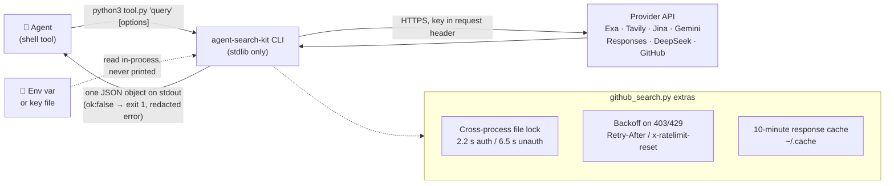

<div align="center">

# 🔎 agent-search-kit

**为研究型 Agent 打造的小巧、统一的搜索与阅读 CLI——每次调用只输出一个 JSON 对象。**

[](https://github.com/sdpwh7-ux/agent-search-kit/actions/workflows/ci.yml)
[](LICENSE)
[](https://www.python.org/)
[](#-功能特性)

[English](README.md) | **简体中文** | [日本語](README.ja.md)

Exa · Tavily · Jina · Gemini grounding · 兼容 OpenAI 的 Responses `web_search`（含 xAI `x_search`）· DeepSeek Search/Fetch · 带限流与缓存的 GitHub 搜索

</div>

---

## 🤔 为什么需要它

编程和研究类 Agent 擅长执行 shell 命令和读取 JSON，却不擅长记住五套不同的搜索 API，以及它们各自的认证头、速率限制和出错方式。

**agent-search-kit** 为它们提供了一套统一约定：

```bash
python3 <tool>.py "query" [options]   ->   one JSON object on stdout
{"channel": "...", "ok": true, "results"|"answer"|"sources": ..., "latency_s": 1.4}
{"channel": "...", "ok": false, "error": "redacted message"}            # exit code 1
```

所有工具的用法都一样，不需要为每个服务商单独写一段提示词。只要告诉 Agent“运行工具，读取 JSON”，它就能使用全部工具。

## ✨ 功能特性

- 🧩 **统一的输出约定**：每个工具都在 stdout 输出一个 JSON 对象；失败时返回 `"ok": false`，退出码为 `1`。
- 📦 **零依赖**：仅使用 Python 3.9+ 标准库，不需要 SDK，也没有常驻进程。
- 🔑 **密钥绝不打印**：密钥来自环境变量或密钥文件，错误信息会做脱敏处理。
- 🌐 **多渠道**：支持 Exa、Tavily、Jina 搜索与阅读、带 Google Search grounding 的 Gemini、任何带托管工具的 Responses API 模型、DeepSeek Search/Fetch 以及 GitHub。
- 🛰️ **流式 Responses 调用**：`web_search.py` 使用流式传输，长时间推理不会触发代理超时。
- 🔁 **阅读器回退**：遇到 401/402/429 时，`jina_read.py` 会回退到免费的无密钥阅读器。
- 🐙 **防限流的 GitHub 搜索**：支持跨进程节流、403/429 退避，以及 10 分钟响应缓存。
- 🧭 **相关项目查找**：`github_search.py similar owner/repo` 可查找相关项目并打分排序。
- 📊 **可选用量统计**：配合 [agent-usage-ledger](https://github.com/sdpwh7-ux/agent-usage-ledger) 使用时，会按 Agent 记录每次 HTTP 调用。
- 🧪 **离线测试**：测试套件使用本地模拟服务器，不需要联网，也不需要真实密钥。

## 🧰 工具一览

| 工具 | 功能 | 需要 |
| --- | --- | --- |
| `exa_search.py` | 神经网络网页搜索，返回摘要片段 | `EXA_API_KEY` |
| `tavily_search.py` | 网页搜索，可选生成综合答案（`--answer`） | `TAVILY_API_KEY` |
| `jina_search.py` | 网页搜索，附带页面 markdown（`--max 0` = 只返回链接） | `JINA_API_KEY` |
| `jina_read.py` | URL -> 干净的 markdown；遇到 401/402/429 时回退到免费无密钥阅读器，可选 `--proxy` | 可选 `JINA_API_KEY` |
| `site_search.py` | 限定在单个域名内搜索（先用 Exa，再用 Tavily） | Exa 或 Tavily 密钥 |
| `gemini_search.py` | 带 Google Search grounding 的 Gemini：答案 + 实际发出的查询 + grounding 来源 | `GEMINI_API_KEY` |
| `web_search.py` | 任何带托管工具（`web_search`、`x_search` 等）的 **Responses API** 模型：答案 + 引用 URL + 搜索次数。采用流式传输，长时间推理不会触发代理超时 | `RESPONSES_API_KEY` / `OPENAI_API_KEY` |
| `deepseek_search.py` | DeepSeek Search / Fetch 工具 API（+ `--balance`）；跨进程 QPS 限流，并对 Fetch 返回的 markdown 做反转义 | `DEEPSEEK_API_KEY` |
| `github_search.py` | `repos`、`similar`（按 topics/关键词/语言查找相关项目并打分）、`readme`、`code`、`issues`、`rate` | 可选 `GITHUB_TOKEN` / `gh` |

## ⚙️ 工作原理



### 为什么 GitHub 工具不只是一层封装

Agent 常常连续发起十次 GitHub 搜索，然后被限流一个小时。`github_search.py` 通过以下机制避免这种情况：

- **跨进程节流**：本机所有 Agent 共享同一个文件锁。已认证的搜索之间间隔 2.2 秒，未认证的间隔 6.5 秒。
- **403/429 退避**：根据 `Retry-After`/`x-ratelimit-reset` 决定等待时间。
- **10 分钟响应缓存**。
- **安全的令牌处理**：令牌不会出现在 argv 或输出中。按 `$GITHUB_TOKEN` -> `$GH_TOKEN` -> `gh auth token` 的顺序查找，并在进程内读取。

`similar owner/repo` 会根据仓库的 topics、描述关键词和语言构造多条查询，合并结果后按共有的稀有 topics、关键词命中和 star 数排序。它适合“查找已有方案 / 竞品”这类任务。

## 🚀 快速开始

### 安装

```bash
git clone https://github.com/sdpwh7-ux/agent-search-kit.git
cd agent-search-kit
cp examples/keys.env.example ~/.config/agent-search.env   # edit, chmod 600, and source it
```

### 使用

```bash
python3 exa_search.py "rust async runtime comparison" -n 5
python3 tavily_search.py "CVE-2026-xxxx nginx" --answer
python3 jina_read.py https://example.com/blog/post --max 8000
python3 site_search.py news.ycombinator.com "self-hosted LLM gateway"
python3 gemini_search.py "What changed in Python 3.14 free-threading?" --thinking high
python3 web_search.py "latest stable Kubernetes release and date" --model "$WEB_SEARCH_MODEL" --effort high
RESPONSES_BASE_URL=https://api.x.ai/v1 RESPONSES_API_KEY=... \
  python3 web_search.py "reactions to the new release" --model grok-4 --tools web_search,x_search
python3 deepseek_search.py search "向量数据库 选型" --n 10 --json
python3 deepseek_search.py fetch https://example.com/article
python3 github_search.py repos "mcp server postgres" --lang python --min-stars 50 --pushed-after 90d
python3 github_search.py similar owner/repo -n 10
python3 github_search.py rate
```

### 让 Agent 用起来

给 Agent 一段简短的指令，例如：

> *“做网页调研时，运行 `/path/to/agent-search-kit` 里的工具，每个工具都会输出 JSON。事实性结论优先用两个相互独立的渠道交叉验证，并引用你用到的 `url`。”*

## 🔧 配置

| 变量 | 默认值 | 含义 |
| --- | --- | --- |
| `AGENT_SEARCH_KEY_DIR` | `~/.config/agent-search` | 密钥文件目录（`exa_key`、`tavily_key`、`jina_key`、`gemini_key`、`deepseek_key`、`responses_key`、`openai_key`），在对应环境变量未设置时使用 |
| `RESPONSES_BASE_URL` | `$OPENAI_BASE_URL` 或 `https://api.openai.com/v1` | `web_search.py` 使用的 Responses API 端点 |
| `WEB_SEARCH_MODEL` | - | `web_search.py` 的默认模型 |
| `GEMINI_BASE_URL` / `GEMINI_SEARCH_MODEL` | Google API / `gemini-flash-latest` | Gemini 端点和模型 |
| `DEEPSEEK_BASE_URL` | `https://api.deepseek.com` | DeepSeek 端点 |
| `AGENT_SEARCH_PROXY` | - | 无密钥 Jina 阅读器使用的代理（`http://...` 或 `socks5h://...`） |
| `AGENT_SEARCH_STATE` / `GITHUB_SEARCH_STATE` | `~/.cache/agent-search` / `~/.cache/github_search` | 限流锁和缓存目录 |
| `AGENT_SEARCH_UA` | `agent-search-kit/0.1` | User-Agent |

**可选用量统计**：把 [agent-usage-ledger](https://github.com/sdpwh7-ux/agent-usage-ledger) 的 `usage_log.py` 加入 `PYTHONPATH` 后，每次 HTTP 调用都会按 Agent（`AGENT_NAME`）记录。

## 🛡️ 安全模型

- 🌐 **网络**：每个工具只与对应服务商的 API（或你配置的 base URL）通信。`jina_read.py` 还会访问 Jina 阅读器，由它去抓取你传入的 URL。查询和 URL 会发送给第三方，因此不要搜索机密信息或私有 URL。
- 🔑 **凭据**：密钥来自环境变量或 `AGENT_SEARCH_KEY_DIR` 中的文件（请设为 `chmod 600`）。密钥只会作为请求头发给对应的服务商，绝不会被打印，错误信息也会做脱敏处理。`github_search.py` 可能在进程内调用 `gh auth token`，令牌不会写入任何地方。带着这些环境变量运行的 Agent 可以消耗你的 API 额度，请在服务商侧设置消费上限。
- 🐚 **Shell**：所有工具都不会启动 shell。`jina_read.py --proxy` 和 `github_search.py --proxy` 以参数列表方式调用 `curl`（不经过 shell），请求头通过 stdin 传入，因此令牌不会出现在 `ps` 中。
- 📁 **文件**：工具只写入限流锁文件和 GitHub 响应缓存（位于 `~/.cache` 下），缓存里只有公开的 API 响应。
- 🧨 **提示词注入**：搜索结果和抓取的页面都是不可信内容。Agent 应把它们当作数据处理，绝不能当作指令执行。

## 🧪 测试

```bash
python3 -m unittest discover -s tests -v   # local fake server; no internet, no real keys
```

## 🗺️ 项目状态与路线图

本项目**刚刚开源**，当前版本为 `0.1`（默认 User-Agent 为 `agent-search-kit/0.1`）。接口可能会根据反馈继续调整。

- [x] 九个 CLI，共用同一套 JSON 输出约定
- [x] 带限流与缓存的 GitHub 搜索，支持 `similar` 排序
- [x] 离线测试套件（本地模拟服务器）
- [ ] 收集真实 Agent 工作流中的反馈，欢迎提交 Issue 和 PR
- [ ] 可能会接入更多遵循同一约定的服务商（只是设想，不作承诺）

## 🤝 参与贡献

欢迎贡献！请遵守项目的几条核心原则：

1. **只用标准库**：不要引入新的运行时依赖。
2. **遵守输出约定**：在 stdout 输出一个 JSON 对象；失败时返回 `"ok": false`，退出码为 `1`。
3. **绝不泄露密钥**：密钥不得出现在输出、错误信息、argv 或文件中。
4. **测试必须离线运行**：提交 PR 前请运行 `python3 -m unittest discover -s tests -v`。

## 📄 许可证

[MIT](LICENSE)

---

### 🧰 Agent 工具集系列

| 仓库 | |
| --- | --- |
| [taskwake](https://github.com/sdpwh7-ux/taskwake) | |
| [**agent-search-kit**](https://github.com/sdpwh7-ux/agent-search-kit) | ← 当前仓库 |
| [streamsafe](https://github.com/sdpwh7-ux/streamsafe) | |
| [agent-usage-ledger](https://github.com/sdpwh7-ux/agent-usage-ledger) | |
| [git-box-sync](https://github.com/sdpwh7-ux/git-box-sync) | |
